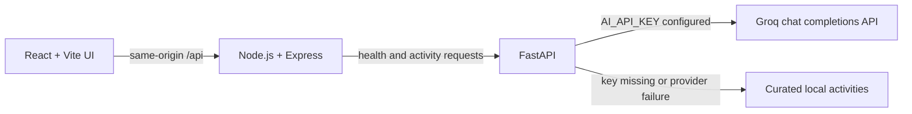

# LoopOut: A 5-Minute Offline Activity to Break the Screen Loop

LoopOut helps people step away from screens with one personalized, five-minute offline activity. Share how a screen session feels, choose an environment or activity preference if useful, then take a short break without a timer, account, or streak.

## What it does

- Collects a short check-in and optional environment and activity preferences.
- Suggests one practical offline activity in Nature, Gentle Movement, or Sensory Grounding.
- Uses the Groq OpenAI-compatible API when configured, with curated local activities available as a fallback.
- Supports the check-in → activity → step-away → return flow, including options to continue, take another break, or finish.
- Does not create user accounts or persist check-in history.

LoopOut is a wellness aid for everyday screen breaks, not a medical or mental-health service.

## Architecture



- **Frontend:** React, TypeScript, Vite, and Tailwind CSS. The browser calls the app's `/api` routes; it never calls the AI provider directly.
- **Web server:** Express starts FastAPI, waits for its health endpoint, proxies `/api` requests, and serves Vite middleware during development or the built `dist/` files in production.
- **Backend:** FastAPI validates requests and response data. The AI service uses the configured OpenAI-compatible endpoint and returns a curated fallback when the key is missing or a provider request fails.
- **Configuration:** Both Node and Python load the root `.env` file. `AI_API_KEY` is server-side only and must never be renamed to a `VITE_` variable.

### Request flow

```text
Check-in form → POST /api/generate-reset → FastAPI → AI or fallback → activity screen
```
## Use cases

- Taking a short pause after a long coding, writing, or study session.
- Choosing a gentle offline activity after meetings or notification-heavy work.
- Finding an indoor-friendly reset when going outside is inconvenient.
- Getting a simple sensory or movement break when a user is unsure what to do next.

## Repository layout

```text
backend/                 FastAPI app, AI service, prompts, schemas, fallbacks, and tests
public/favicon.svg       LoopOut app icon
src/                     React app, screens, API client, and styles
.env.example             Safe configuration template
package.json             Frontend/server scripts and npm dependencies
package-lock.json        Reproducible npm dependency lockfile
requirements.txt         Python dependencies
server.ts                Express server and FastAPI process orchestration
```

LoopOut is distributed under the [MIT License](./LICENSE).
